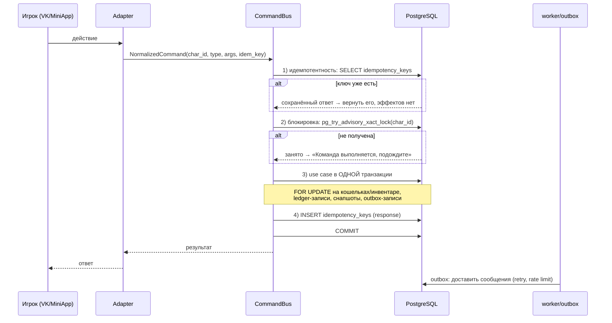

# Архитектурный план — Текстовая космическая MMORPG (MVP)

Версия 1.0 • 23 ноября 2026 г.
Статусы: `[план]` — запланировано к реализации в MVP; `[решение]` — предложение ИИ-агента, требует согласования (см. `04-decisions.md`); `[вне MVP]` — сознательно исключено.

---

## 1. Цели и ограничения

**Цели архитектуры (выведены из ТЗ):**

1. Игровое ядро изолировано от платформ: VK сейчас, Telegram — без переписывания ядра. (ТЗ, «Ключевые требования»)
2. Команды игрока обрабатываются строго последовательно: пока одна выполняется, новые отклоняются с сообщением о занятости. (ТЗ, «Надёжность»)
3. Платёжи, торговля, награды, инвентарь, таймеры — атомарны и идемпотентны; недоступность платформы не приводит к потере/дублированию подтверждённых операций. (ТЗ, «Надёжность»)
4. Максимум переменных, формул и параметров объектов редактируется через админ-UI без изменения кода; безопасные изменения — без перезапуска. (ТЗ, «Админ-панель»)
5. Архитектурно предусмотреть будущий блочный конструктор механик (реализация отложена). (ТЗ, «Будущие системы»)

**Явно вне MVP:** PvP, войны фракций, совместные экспедиции, встречи игроков, побег противников, игроки-лидеры фракций, разведка. Не закладываем в модель данных специфики этих систем, но не запрещаем их добавить позже.

---

## 2. Технологический стек `[решение]`

| Компонент | Предложение | Обоснование |
|---|---|---|
| Язык backend | Python 3.12 | Быстрая итерация контент-логики, зрелая экосистема; типизация через type hints + mypy |
| HTTP/API | FastAPI (asyncio) | Mini App API, админ API, webhooks платёжного провайдера |
| ORM/миграции | SQLAlchemy 2.x + Alembic | Контроль транзакций, FOR UPDATE, advisory locks |
| СУБД | PostgreSQL 16 | Транзакции, constraints, JSONB для контента/снапшотов, advisory locks |
| Кэш/блокировки/рейт-лимит | Redis 7 | Per-character locks, hot-cache конфигурации, rate limiter исходящих сообщений |
| Фоновые задачи | ARQ (async, Redis) + собственный планировщик таймеров | Таймеры крафта/возвращения/лотов — точность в секундах, retry с бэкоффом |
| Бот-адаптеры | VK Bots API (Long Poll); интерфейс под Telegram Bot API | Long Poll проще для MVP (не нужен публичный webhook) |
| Mini App / Админ-UI | React SPA (отдельные сборки), общий backend API | VK Mini Apps требует JS-фронта; админка — отдельная ролевая SPA |
| Наблюдаемость | JSON-логи + Prometheus/Grafana + Sentry | Требования ТЗ к мониторингу |
| Деплой MVP | Docker Compose на одном VPS (volumes + ежедневный pg_dump) | MVP-нагрузка; горизонтальное масштабирование — позже |

Альтернативы: Node.js/NestJS или Go — если команда сильнее в них; ядро на это не завязано. **Окончательный выбор — открытый вопрос №1 в `04-decisions.md`.**

---

## 3. Структурная схема (hexagonal / ports & adapters)

```
┌────────────────────────────────────────────────────────────────────┐
│                         АДАПТЕРЫ (ввод/вывод)                       │
│  ┌───────────┐  ┌──────────────┐  ┌───────────────┐  ┌───────────┐ │
│  │ vk-adapter│  │ telegram-    │  │ miniapp-api   │  │ admin-api │ │
│  │ (bot)     │  │ adapter      │  │ (REST для     │  │ (REST для │ │
│  │           │  │ (интерфейс   │  │  Mini App)    │  │  админки) │ │
│  └─────┬─────┘  │  готов)      │  └──────┬────────┘  └─────┬─────┘ │
│        │        └──────────────┘         │                 │       │
│        │        ┌──────────────┐         │                 │       │
│        │        │ payments-web │         │                 │       │
│        │        │ hook         │         │                 │       │
│        │        └──────┬───────┘         │                 │       │
└────────┼───────────────┼─────────────────┼─────────────────┼───────┘
         │               │                 │                 │
         ▼               ▼                 ▼                 ▼
┌────────────────────────────────────────────────────────────────────┐
│                    СЛОЙ ПРИЛОЖЕНИЯ (use cases)                      │
│  Command Bus │ Use-Case Handlers │ Транзакции │ Идемпотентность     │
│  Per-character lock │ Outbox записи │ Снапшоты контента              │
└───────────────────────────┬────────────────────────────────────────┘
                            │
┌───────────────────────────▼────────────────────────────────────────┐
│                       ИГРОВОЕ ЯДРО (domain)                         │
│  ExpeditionEngine │ BattleEngine │ InventoryService │ WalletService │
│  CraftService │ MarketService │ QuestService │ ProgressionService   │
│  Правила: топливо, поломки (−5% макс. прочности), отступление,      │
│  потери при поражении, «Ожидает получения», уникальные предметы...  │
│  НЕ зависит от VK/Telegram/HTTP/БД. Только доменные типы.           │
└───────────────────────────┬────────────────────────────────────────┘
                            │
┌───────────────────────────▼────────────────────────────────────────┐
│                      ИНФРАСТРУКТУРА                                 │
│  PostgreSQL (данные + outbox + таймеры) │ Redis (locks, cache, RL)  │
└────────────────────────────────────────────────────────────────────┘
         ▲
         │ читает/шлёт
┌────────┴───────────────────────────────────────────────────────────┐
│  worker: планировщик таймеров · диспетчер outbox · расчёты рынка    │
└────────────────────────────────────────────────────────────────────┘
```

**Правило зависимостей:** зависимости смотрят только вниз. Адаптеры знают о слое приложения; ядро не знает ни об адаптерах, ни о БД (через интерфейсы репозиториев). Подключение Telegram = добавление одного адаптера + регистрация в диспетчере.

---

## 4. Список сервисов (компонентов деплоя)

| # | Компонент | Назначение | Ключевые обязанности |
|---|---|---|---|
| S1 | `vk-adapter` | Приём/отправка сообщений VK | Long Poll, нормализация команд, подпись/проверка источника, ответ «занят», рендер текстовых ответов |
| S2 | `telegram-adapter` `[вне MVP, интерфейс готов]` | То же для Telegram | Без изменений ядра; единый формат нормализованной команды |
| S3 | `miniapp-api` | REST API для VK Mini App | Аутентификация по подписанным launch params, профиль, инвентарь, развитие, справочник, боевой журнал, крафт-UI |
| S4 | `admin-api` + `admin-ui` | Админ-панель | RBAC (администратор/модератор/контент-менеджер), редактирование конфигов/контента, аудит-лог, аналитика |
| S5 | `worker` | Фоновая обработка | Планировщик таймеров (лидер через advisory lock), диспетчер outbox с rate limit и retry, сведение ордеров рынка Эонов, истечение лотов/передаток |
| S6 | `core` (библиотека, не процесс) | Игровое ядро | Все правила ТЗ; используется S1–S5 |
| S7 | `postgres`, `redis` | Состояние | Единственный источник истины; Redis — эфемерное |
| S8 | `backup-agent` | pg_dump по расписанию → объектное хранилище, ротация, проверка восстановления | Требование ТЗ к резервному копированию |

Все компоненты одного репозитория (монорепо): `core/`, `app/`, `adapters/vk|tg|http`, `admin/`, `worker/`, `deploy/`. Общие пакетные границы защищают правило «правила только в ядре».

---

## 5. Ключевые проектные решения

### 5.1 Конвейер команды (един для бота, Mini App, админки)



- **Последовательность:** advisory lock на ID персонажа в рамках транзакции = гарантия ТЗ «пока выполняется одна команда, новые игнорируются с сообщением о занятости». Lock автоматически снимается при rollback/commit — нет «зависших» блокировок при падении.
- **Идемпотентность:** ключ = `hash(char_id, command_type, args)` для бота / клиентский UUID для Mini App / `provider_payment_id` для платежей. Таблица `idempotency_keys` хранит ответ; повтор — возврат того же ответа без побочных эффектов.
- **Outbox:** сообщения игроку пишутся в таблицу `outbox` в той же транзакции, что и эффект. Диспетчер шлёт с учётом лимитов VK/Telegram, экспоненциальным бэкоффом; платформа недоступна → сообщения накопятся и дойдут позже. Эффект уже зафиксирован, дубля нет (каждая запись outbox отправляется по id с учётом статуса).

### 5.2 Конфигурация и контент без перезапуска

- Скаляры баланса (топливо, цены, налоги, вероятности, лимиты, таймеры) — в `config_params` (JSONB + JSON-schema). Админ-UI редактирует с валидацией схемы; кэш в Redis с инвалидацией — применение без рестарта.
- Формулы — в `formulas` как строки; вычисление через безопасный AST-вычислитель (белый список операторов/функций). `[решение: подход к формулам]`
- Контент-шаблоны (предметы, враги, события, рецепты, таблицы дропа/вероятностей) — таблицы с `status: draft/published`, версионирование (`version`, `updated_at`, кто менял).
- **Снапшотинг:** при старте боя/события/экспедиции параметры шаблона копируются в инстанс (JSONB). Баланс-правка админом не искажает уже идущий бой/экспедицию — воспроизводимость и отсутствие споров «почему я проиграл после апдейта цифр».
- **Конструктор механик (будущее):** событие/эффект хранит `behavior` как JSON-граф узлов (условие→действие). В MVP `behavior` заполняется из кода-загрузчика контента, но схема поля — сразу граф, чтобы визуальный конструктор стал редактором этого JSON, а не переломом схемы.

### 5.3 Боевая система

- Бой — **синхронный конечный автомат** в БД: `battles.state` (JSONB: HP противника, эффекты, номер хода, флаги). Ход игрока = команда = транзакция; переводит автомат в новое состояние, пишет `battle_turns` (краткий итог + подробный журнал).
- Пассив игрока: ход противника **не** исполняется автоматически (ТЗ) — бой ждёт следующей команды; таймеров в бою нет.
- Противник — снапшот `enemy_templates` на момент начала боя; простая логика выбора действия из weighted-таблицы (категории: обычный/опасный/элитный/босс; пассивы и слабости — только элит/босс).
- Отступление: 1 попытка за бой, шанс из `config_params`; успех → противник исчезает, награды нет, бросок на повреждение/поломку (вероятности настраиваются); провал → попытка израсходована.
- Поражение: автовозврат в космопорт; потеря случайной доли добычи экспедиции в админском диапазоне — только предметы с флагом `losable_on_defeat`; редкие/уникальные по умолчанию защищены (флаг на предмет). Текущая прочность падает, возможны поломки; корабль не уничтожается; топливо сохраняется; наказание не эскалирует автоматически.
- Поломки: `malfunctions` счётчик; макс. прочность = `base_max × (1 − 0.05 × n)` (константа ТЗ, коэффициент — в конфиге). Ремкомплект: −1 поломка, возврат максимума; хил — только текущая прочность. Это разграничение проверяется тестами.

### 5.4 Экспедиции и события

- Экспедиция = запись `expeditions` + сгенерированная при старте очередь событий (seed + последовательность из `event_tables` по весам/условиям). Глубина не влияет на сложность (ТЗ) — глубина только счётчик прогресса.
- Топливо тратится на действие/событие; при 0 — автовозврат + поломки. Добровольный возврат: разрешён всегда (кроме боя/события/непрерываемого действия), задержка (таймер), два сообщения (старт/прибытие), топливо сохраняется, без штрафов. **Три сценария возврата (добровольный/топливо/поражение) — три разных reason-кода**, это критическое разграничение ТЗ.
- Офлайн-заморозка: пока игрок офлайн, экспедиция не тикает (топливо не тратится, случайные события/бои не стартуют). Продолжают работать только явные таймеры (возвращение, крафт, лоты, передатки) — через `timers` + worker.
- События: уникальные ≤1 за экспедицию (контроль по флагу шаблона), обычные повторяются; таймера истечения в MVP нет; завершённое закрыто окончательно.

### 5.5 Экономика и торговля

- **Кошельки — ledger-архитектура:** `wallets` (материализованный баланс) + `wallet_ledger` (append-only, причина, ссылка на операцию, idempotency_key UNIQUE). Изменение баланса только парой «запись ledger → обновление wallet» в одной транзакции с `FOR UPDATE`. Движения «ниоткуда/в никуда» запрещены триггером-инвариантом на уровне сервиса (mint/burn — особыми причинами).
- **Резервирование:** при аукционе/передатке/покупке активы списываются в резерв (ledger-причина `reserve`), при отмене/истечении — возврат из резерва. Невозможно потерять актив в «подвешенном» состоянии.
- **Аукцион:** лоты + ставки; комиссия 1% (config); лимит активных лотов 5/10 (config); отмена без ставок → возврат предмета через 20 мин (таймер); уникальные не продаются; установленный модуль требует снятия.
- **Прямая передача:** только в космопорте; флаги «запрет продажи» и «запрет передачи» независимы (ТЗ); свыше порогов ценности — оффер со статусом `pending_confirmation`, активы в резерве, срок (config), исполнение после подтверждения получателя.
- **Рынок Эонов:** ордерная книга (buy/sell) со сведением worker'ом; спред/комиссия 10% с продавца/курс — в `market_config` с историей; защита от манипуляций: лимиты на размер/частоту ордеров, валидация отклонения курса от скользящего ориентира. `[решение: модель ордерной книги]`
- **Платежи:** webhook от провайдера → идемпотентная обработка (`provider_payment_id` UNIQUE), зачисление Эонов через ledger, состояния `pending/paid/refunded/failed`. Провайдер — открытый вопрос ТЗ. Тестовая среда без реальных платежей.

### 5.6 Таймеры

Единая таблица `timers` (тип, владелец, payload, fires_at, статус). Worker-лидер (advisory lock) выбирает просроченные → каждый таймер = команда в конвейере 5.1 (идемпотентно, по id таймера). Отмена крафта/лота/передатки — flip статуса таймера в той же транзакции, что и возврат средств.

### 5.7 Надёжность и эксплуатация `[план]`

- Окружения: `dev` / `staging` (отдельный бот-группа VK, без реальных платежей) / `prod`. Миграции — Alembic, обязательный `pg_dump` перед применением на prod.
- Мелкие обновления: rolling restart контейнеров (двойная буферизация не нужна при per-char advisory locks); крупные — флаг обслуживания (бот отвечает «техработы»), блокировка новых команд, дожидание активных транзакций.
- Мониторинг: команды/сек, доля «занято», ошибки по use-case, время транзакций, глубина outbox, лаг таймеров, объёмы рынка, активные игроки (дэшборд Grafana); алерты Sentry + Prometheus Alertmanager.
- Аудит: `audit_log` (actor, роль, действие, target, diff before/after, IP, время) — все действия администраторов/модераторов/контент-менеджеров. Модератор применяет только существующие эффекты (белый список `effect_templates`).
- Безопасность: секреты в env/vault, подпись VK launch params для Mini App, верификация платёжных webhook'ов, rate limit на команды, экранирование пользовательских строк, проверка имён персонажей (blacklist-регексы + ручная модерация), баны с разблокировкой.

---

## 6. Трассировка требований ТЗ → архитектура

| Требование ТЗ | Решение |
|---|---|
| Подключить Telegram без переписывания ядра | Hexagonal: адаптеры за портом, общий NormalizedCommand (§3, S2) |
| Последовательность команд, «занятость» | Per-character advisory xact lock (§5.1) |
| Атомарность/идемпотентность денег, предметов, наград, таймеров | Одна транзакция на use case, idempotency_keys, ledger, резервы, outbox (§5.1, §5.5) |
| Недоступность платформы ≠ потеря/дубли | Outbox с retry + ровно-одна-запись-на-эффект (§5.1) |
| Правки баланса через UI без кода и рестарта | config_params + формулы + снапшотинг (§5.2) |
| Конструктор механик «потом» | behavior как JSON-граф в схеме сразу (§5.2) |
| Три сценария возвращения | reason-коды + отдельные ветки ядра + тесты (§5.4) |
| Дроп vs «Ожидает получения» | Разные ветки: дроп при полном инвентаре теряется, результат таймера — в waiting (§5.5, инвентарь в `02-data-model.md`) |
| Роли админ-панели, аудит | RBAC + audit_log (§5.7) |
| Офлайн: экспедиция заморожена, таймеры живут | Нет тикера экспедиции; только timers+worker (§5.4, §5.6) |
