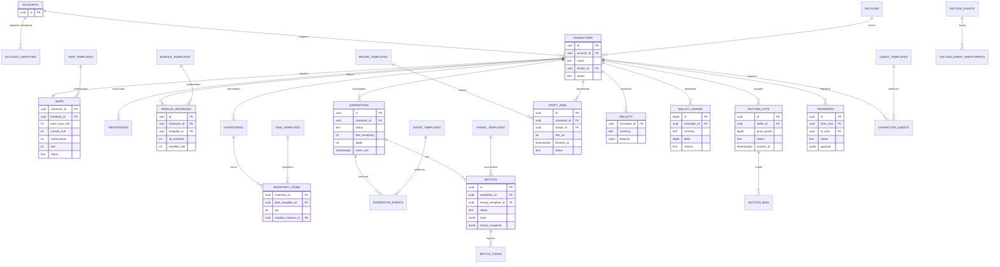

# Модель данных — Текстовая космическая MMORPG (MVP)

Версия 1.0 • 23 ноября 2026 г.
СУБД: PostgreSQL 16 `[решение]`. Соглашения: PK `uuid` (gen_random_uuid()), все таблицы имеют `created_at timestamptz not null default now()` (не дублируется в списках полей). Деньги — `bigint`. Перечисления — `text` + CHECK (или PG enum; в миграциях уточнится).

---

## 1. ER-диаграмма (основные сущности)

---

## 2. Аккаунты и персонажи

### `accounts`
Единый игровой аккаунт (прогресс не привязан к платформе — ТЗ).

| Поле | Тип | Примечание |
|---|---|---|
| id | uuid PK | |
| status | text CHECK in (active, banned, deleted) | |
| ban_until | timestamptz NULL | временный бан (модератор) |
| ban_reason | text NULL | |
| banned_by | uuid NULL → admin_users | аудит |
| last_login_at | timestamptz | аналитика |

### `account_identities` — привязка VK/Telegram к аккаунту
| Поле | Тип | Примечание |
|---|---|---|
| account_id | uuid FK | |
| platform | text CHECK in (vk, telegram) | |
| platform_user_id | text | **UNIQUE(platform, platform_user_id)** |
| linked_at, verified_at | timestamptz | верифицированная привязка — открытый вопрос ТЗ №8 |
| link_token_hash | text NULL | одноразовый код привязки второй платформы |

### `characters`
| Поле | Тип | Примечание |
|---|---|---|
| id | uuid PK | уникальный ID (ТЗ: имя может повторяться) |
| account_id | uuid FK | один аккаунт — несколько персонажей `[допущение: лимит 1 в MVP]` |
| name | text | не уникально; проверка blacklist-регексами + модерация |
| name_normalized | text | lower(trim(name)) — для поиска/модерации |
| faction_id | uuid FK → factions | |
| status | text CHECK in (active, blocked) | удаление игроком не предусмотрено (ТЗ) |
| tutorial_state | jsonb | прогресс обязательного обучения/первой экспедиции |
| craft_slots | int | базовые производственные слоты `[число — открытый вопрос ТЗ]` |
| inventory_size | int | 30 базово; +50% подписка `[решение: производные от подписки считать на лету, см. subscriptions]` |
| warehouse_size | int | склад: расширяемый |
| faction_changed_at | timestamptz NULL | старт cooldown смены фракции |
| xp_pool | bigint | общий опыт персонажа (не теряется при сбросе — ТЗ) |

**Инварианты:** смена фракции → в `reputations` старая строка `is_active=false` (сохраняется), новая создаётся с отрицательным стартом (значение — config); cooldown (config) проверяется в ядре. Особые звания — не в этой таблице (см. `character_titles`).

### `reputations`
| Поле | Тип | Примечание |
|---|---|---|
| character_id, faction_id | uuid FK | **PK** |
| value | int | индивидуальная репутация |
| is_active | bool | одна активная репутация на персонажа (частичный уникальный индекс `WHERE is_active`) |

### `character_titles` — особые звания за достижения (сохраняются при смене фракции)
| Поле | Тип |
|---|---|
| character_id, title_code | **PK** (title_code → config/справочник) |
| granted_at, granted_by (uuid NULL — система) | |

### `character_effects` — наложенные эффекты (модераторы, события, боссы)
| Поле | Тип | Примечание |
|---|---|---|
| id | uuid PK | |
| character_id | uuid FK | цель |
| effect_template_id | uuid FK → effect_templates | модератор применяет только существующие (ТЗ) |
| source_type | text | moderator/event/battle/admin_system |
| source_id | uuid NULL | кто/что наложил (аудит) |
| params | jsonb | сила, стек и т.п. |
| applied_at, expires_at | timestamptz NULL | |

---

## 3. Фракции, задания, фракционные события

### `factions`
| Поле | Тип | Примечание |
|---|---|---|
| id | uuid PK | |
| code | text UNIQUE | e.g. `void_walkers` |
| name, description | text | |
| bonuses | jsonb | бонусы фракции (параметризованы конфигом) |
| start_resources | jsonb | стартовые ресурсы/корабль новичка (ссылки на шаблоны) |

### `faction_relations` — отношения между фракциями (отделены от репутации игроков — ТЗ)
| Поле | Тип |
|---|---|
| faction_a, faction_id | uuid FK, **PK(a,b)**, a≠b |
| relation | text CHECK in (war, neutral, allied, truce) |
| updated_by, updated_at | аудит |

### `quest_templates`
| Поле | Тип | Примечание |
|---|---|---|
| id | uuid PK | |
| faction_id | uuid FK NULL | null = общий квест |
| code | text UNIQUE | |
| kind | text CHECK in (story, tutorial, side, faction_event) | первый сюжетный обязателен (ТЗ) |
| chain_order | int | порядок в цепочке |
| requirements | jsonb | репутация/уровень/флаги |
| rewards | jsonb | предметы/валюта/опыт (ссылки на шаблоны) |
| status | text CHECK in (draft, published, archived) | контент-менеджер публикует в своей зоне (ТЗ) |

### `character_quests`
| Поле | Тип | Примечание |
|---|---|---|
| character_id, quest_id | **PK** | |
| status | text CHECK in (active, completed, locked) | |
| progress | jsonb | счётчики целей |
| completed_at | timestamptz NULL | |

### `faction_events` — общие цели, индивидуальный вклад (ТЗ)
| Поле | Тип | Примечание |
|---|---|---|
| id | uuid PK | |
| config | jsonb | цели, окно, награды, условия (триггер: schedule/random/condition/manual — ТЗ) |
| starts_at, ends_at | timestamptz | |
| status | text CHECK in (scheduled, active, finished, cancelled) | запуск вручную/планировщиком |
| created_by | uuid → admin_users | |

### `faction_event_participants`
| Поле | Тип |
|---|---|
| event_id, character_id | **PK** |
| contribution | jsonb | индивидуальный вклад |
| rewards_granted | bool | |

---

## 4. Корабль и модули

### `ship_templates`
| Поле | Тип |
|---|---|
| id, code UNIQUE | uuid / text |
| faction_id | uuid FK NULL (общие шаблоны — null) |
| name | text |
| base_stats | jsonb — max_hull, fuel_capacity, base slots, характеристики атаки/защиты |
| module_slots | int |

### `ships` (1:1 к персонажу в MVP)
| Поле | Тип | Примечание |
|---|---|---|
| character_id | uuid PK FK | |
| template_id | uuid FK | |
| base_max_hull | int | снапшот из шаблона при выдаче; растёт с развитием (config-формула) |
| current_hull | int | текущая прочность = здоровье (ТЗ) |
| malfunctions | int ≥ 0 | поломки; макс. = base_max × (1 − 0.05×n) — **вычисляется, не хранится** |
| fuel | int ≥ 0 | |
| status | text CHECK in (dock, expedition, returning, battle) | корабль не уничтожается окончательно (ТЗ) |

**Разграничение ТЗ:** ремкомплект → `malfunctions −1` (возврат максимума); способности/навыки/расходники → `current_hull +` (восстановление здоровья). Разные коды операций, покрыто тестами.

### `module_templates`
| Поле | Тип | Примечание |
|---|---|---|
| id, code UNIQUE | uuid / text |
| name, description | text | |
| kind | text CHECK in (ability, skill) | способности активные, навыки пассивные (ТЗ) |
| faction_id | uuid FK NULL | |
| params | jsonb | эффекты/урон/стоимость энергии и т.д. |
| max_per_ship | int | допустимое число одинаковых модулей — настройка модуля (ТЗ) |
| in_combat_restrictions | jsonb | разрешённые/запрещённые в бою средства (ТЗ) |
| status | draft/published | |

### `module_instances`
| Поле | Тип | Примечание |
|---|---|---|
| id | uuid PK | полученный модуль сразу доступен, изучение не нужно (ТЗ) |
| character_id, template_id | uuid FK | |
| xp_invested | int ≥ 0 | распределение опыта — только в космопорту (ТЗ) |
| installed_slot | int NULL | null = в инвентаре; снятие не теряет прогресс (ТЗ) |

**Инварианты:** UNIQUE(character_id, template_id, installed_slot) при установке; контроль `max_per_ship` в ядре; сброс распределения опыта — спец. предмет/ресурс, формула повторных сбросов из config, общий xp_pool не тратится.

### `effect_templates` — справочник эффектов (белый список для модераторов — ТЗ)
| Поле | Тип |
|---|---|
| id, code UNIQUE | uuid / text |
| scope | text — character/ship/enemy/module |
| params_schema | jsonb — что редактируется |
| duration_default | int сек |

---

## 5. Инвентарь, склад, «Ожидает получения»

### `item_templates`
| Поле | Тип | Примечание |
|---|---|---|
| id, code UNIQUE | uuid / text |
| name, description | text | |
| category | text CHECK in (resource, consumable, module, repair_kit, special, currency_mat) | |
| rarity | text CHECK in (common, rare, epic, unique) | |
| stack_limit | int | индивидуальный лимит стека (ТЗ) |
| is_unique | bool | нельзя получить повторно при наличии; нельзя продавать (ТЗ) |
| sellable | bool | независим от tradable (ТЗ) |
| tradable | bool | запрет передачи независим от запрета продажи (ТЗ) |
| losable_on_defeat | bool | по умолчанию: common потеря возможна, rare/unique — защищены (ТЗ) |

### `inventories`
| Поле | Тип | Примечание |
|---|---|---|
| id | uuid PK | |
| character_id | uuid FK | |
| kind | text CHECK in (ship, warehouse, waiting) | ship=инвентарь 30 (+50% подписка), warehouse=склад космопорта, waiting=**«Ожидает получения», безлимитный** (ТЗ) |
| size_limit | int NULL | NULL = безлимит (только waiting) |

### `inventory_items`
| Поле | Тип | Примечание |
|---|---|---|
| inventory_id, item_template_id | uuid FK | |
| qty | int ≥ 1 | ≤ template.stack_limit; уникальные: qty=1 |
| module_instance_id | uuid FK NULL | для предметов-модулей (экземпляр) |
| acquired_at | timestamptz | сортировка waiting-раздела |

**Критические инварианты ТЗ:**
1. Прямой дроп при заполненном инвентаре → **предмет не выпадает** (потеря допустима).
2. Результат таймера (крафт), не поместившийся в инвентарь → **в waiting**, не исчезает. Разные ветки кода + тесты.
3. Уникальный предмет: нельзя получить второй экземпляр в инвентаре; продажа запрещена (tradable/sellable отдельно).
4. При освобождении места предметы из waiting **автоматически** возвращаются в инвентарь (worker-задача на событие освобождения слота).
5. Склад недоступен в экспедиции и PvP — проверка `ships.status` в use-case (PvP вне MVP, проверка заложена).

---

## 6. Экспедиции и события

### `expeditions`
| Поле | Тип | Примечание |
|---|---|---|
| id | uuid PK | |
| character_id | uuid FK | одна активная на персонажа (уникальный индекс WHERE status in (active, returning)) |
| status | text CHECK in (active, returning, completed, aborted_defeat, aborted_fuel) | **три сценария завершения — ТЗ** |
| started_at | timestamptz | |
| fuel_at_start, fuel_remaining | int | |
| depth | int ≥ 0 | прогресс; сложность от глубины НЕ зависит (ТЗ) |
| event_queue | jsonb | сгенерированная при старте последовательность событий (seed+шаблоны) |
| queue_pos | int | текущая позиция |
| return_reason | text CHECK in (voluntary, fuel_empty, defeat) | разграничение сценариев |
| return_eta | timestamptz NULL | задержка возвращения (только voluntary; значение — config) |
| arrived_at | timestamptz NULL | |

### `event_templates`
| Поле | Тип | Примечание |
|---|---|---|
| id, code UNIQUE | uuid / text |
| kind | text CHECK in (interactive, automatic) | интерактивные/автоматические (ТЗ) |
| danger_range | int4range | точная опасность скрыта от игрока (показывается низкая/средняя/высокая — из config-порогов) |
| conditions | jsonb | репутация/фракция/флаги/мин. топливо |
| choices | jsonb | варианты → исходы (характеристики/модули/рандом/особые последствия — ТЗ) |
| is_unique_per_expedition | bool | уникальные ≤1 за экспедицию (ТЗ) |
| can_refuse | bool | отказ зависит от типа события (ТЗ) |
| fuel_cost | int | топливо на событие |
| status | draft/published | |

### `event_tables` + `event_table_entries` — взвешенные таблицы генерации (ТЗ)
| Таблица | Поля |
|---|---|
| event_tables | id, code UNIQUE, description |
| event_table_entries | table_id FK, event_template_id FK, weight int, conditions jsonb NULL |

### `expedition_events`
| Поле | Тип | Примечание |
|---|---|---|
| id | uuid PK | |
| expedition_id | uuid FK | |
| event_template_id | uuid FK | |
| seq | int | позиция в очереди |
| status | text CHECK in (offered, resolved, declined, blocked_full_inventory) | завершённое закрыто окончательно (ТЗ); истечения по таймеру нет (ТЗ) |
| snapshot | jsonb | снапшот шаблона на момент генерации (воспроизводимость) |
| resolution | jsonb NULL | выбор, бросок, исход, добыча |
| resolved_at | timestamptz NULL | |

**Офлайн-заморозка (ТЗ):** тикера экспедиции нет. Прогресс — только по командам игрока онлайн. Автовозврат по топливу происходит в момент траты последнего топлива.

---

## 7. Боевая система

### `enemy_templates` (характеристики одинаковы для всех фракций — ТЗ)
| Поле | Тип | Примечание |
|---|---|---|
| id, code UNIQUE | uuid / text |
| category | text CHECK in (normal, dangerous, elite, boss) | |
| name | text | |
| stats | jsonb | hull, damage, инициатива-порядок |
| ability_ids | jsonb | массив ссылок на `enemy_abilities` (активные способности; у обычных — простая логика) |
| passives | jsonb | только elite/boss (CHECK в миграции) |
| weaknesses | jsonb | только elite/boss |
| loot_table_id | uuid FK | |
| behavior | jsonb | граф узлов `[будущий конструктор механик]`; в MVP — загружается из кода |

### `enemy_abilities` | id, code UNIQUE, name, params jsonb, cooldown int

### `loot_tables` + `loot_entries`
| Таблица | Поля |
|---|---|
| loot_tables | id, code UNIQUE |
| loot_entries | table_id FK, item_template_id FK, weight, qty_min, qty_max, chance numeric |

### `battles`
| Поле | Тип | Примечание |
|---|---|---|
| id | uuid PK | |
| expedition_id | uuid FK NULL | бой вне экспедиции — NULL (будущее) |
| expedition_event_id | uuid FK NULL | источник боя |
| character_id | uuid FK | индекс для per-char lock |
| enemy_template_id | uuid FK | |
| enemy_snapshot | jsonb | снапшот врага на старте |
| player_snapshot | jsonb | характеристики/модули/расходники на старте |
| state | jsonb | HP противника, эффекты обеих сторон, номер хода, очерёдность (базово игрок→противник; могут менять эффекты — ТЗ) |
| status | text CHECK in (active, won, lost, retreated) | |
| retreat_used | bool | одна попытка отступления (ТЗ) |
| consumables_used_this_turn | int | лимит расходников за ход — config |

### `battle_turns` — журнал (append-only)
| Поле | Тип |
|---|---|
| id bigint PK, battle_id FK | |
| turn_no, actor (player/enemy), action jsonb | |
| summary text | краткий итог (по умолчанию — ТЗ) |
| log jsonb | подробный журнал (по запросу — ТЗ) |

**Инварианты ТЗ:** нет автоматического хода противника при бездействии игрока (бой стоит); пропуск хода только под эффектом; смена модулей в бою запрещена (проверка use-case); вероятности действий показываются диапазонами (вычисление из params + config-пороги); опыт за противника — только при победе; награды начисляются атомарно в той же транзакции, что и перевод боя в `won`.

---

## 8. Крафт

### `recipe_templates`
| Поле | Тип | Примечание |
|---|---|---|
| id, code UNIQUE | uuid / text |
| result_item_id | uuid FK → item_templates | |
| result_qty | int | |
| materials | jsonb | [{item_id, qty}] |
| duration_sec | int | таймер идёт в реальном времени, даже офлайн (ТЗ) |
| cancel_return_pct | numeric | частичный возврат при отмене — config/recipe |
| requirements | jsonb | фракция/репутация/здание-нет (строительства нет — ТЗ) |
| status | draft/published | |

### `craft_jobs`
| Поле | Тип | Примечание |
|---|---|---|
| id | uuid PK | |
| character_id, recipe_id | uuid FK | |
| slot_no | int | ≤ character.craft_slots (базовое число — открытый вопрос ТЗ) |
| started_at, finishes_at | timestamptz | |
| status | text CHECK in (running, done, cancelled) | завершение обрабатывает worker по `timers` |

**Инварианты ТЗ:** запуск только при полных материалах (иначе — список нехваты, ничего не списывается); отмена → возврат % материалов, время не компенсируется; результат не влез → waiting; завершения группируются в уведомления, важные — отдельно. Производство и склад — только в космопорту.

---

## 9. Экономика и торговля

### `wallets`
| Поле | Тип | Примечание |
|---|---|---|
| character_id, currency | **PK**, currency CHECK in (eon, quant) | Триний — материал (item), не валюта (ТЗ) |
| balance | bigint ≥ 0 | |
| version | int | optimistic lock |

### `wallet_ledger` — append-only, единственный путь изменения баланса
| Поле | Тип | Примечание |
|---|---|---|
| id | bigint PK | |
| character_id, currency | uuid/text | |
| delta | bigint ≠ 0 | |
| balance_after | bigint | контрольная сумма для сверки |
| reason | text | reward/sale/purchase/craft_fee/tax/commission/reserve_in/reserve_out/mint/burn/refund… |
| ref_type, ref_id | text/uuid NULL | ссылка на операцию (лот, передатку, платёж…) |
| idempotency_key | text | **UNIQUE** — повторная операция технически невозможна |
| actor | text | system/player/admin id |

**Эоны не выводятся в рубли** (ТЗ) — причина `burn` только за покупки наборов/подписки внутри игры.

### `market_config` — курс Эонов, спред, лимиты (история изменений)
| Поле | Тип |
|---|---|
| key, value jsonb, updated_by, updated_at | |
| UNIQ key | ориентир 10 Эонов ≈ 10 000 Квантов, buy 11 000 / sell 9 000 — стартовые значения из ТЗ |

### `eon_market_orders`
| Поле | Тип | Примечание |
|---|---|---|
| id | uuid PK | |
| character_id | uuid FK | |
| side | text CHECK in (buy, sell) | |
| amount_eon | bigint | лимиты на размер/частоту — config |
| price_quant | bigint | |
| status | text CHECK in (open, partial, matched, cancelled) | сведение — worker |
| filled_eon | bigint ≥ 0 | |

### `auction_lots`
| Поле | Тип | Примечание |
|---|---|---|
| id | uuid PK | |
| seller_id | uuid FK | |
| item | предмет: (item_template_id+qty) ИЛИ module_instance_id | модуль сначала снять (ТЗ) |
| min_price_quant, buyout_quant | bigint NULL | |
| status | text CHECK in (active, sold, expired, cancelled_pending_return) | отмена без ставок → предмет возвращается через 20 мин (timer; значение — config) |
| expires_at | timestamptz | |
| commission_pct | numeric | 1% default (config) |

### `auction_bids` | id, lot_id FK, bidder_id FK, amount, at; лот продаётся по правилам из config `[решение: аукцион со ставками + выкуп]`

### `transfers` — прямая передача (только космопорт, ТЗ)
| Поле | Тип | Примечание |
|---|---|---|
| id | uuid PK | |
| from_id, to_id | uuid FK | |
| payload | jsonb | предметы (шаблон+qty / module_instance) и/или quant |
| status | text CHECK in (pending_confirmation, active, completed, expired, rejected, cancelled) | пороги ценности — config; до подтверждения активы в резерве (ТЗ) |
| expires_at | timestamptz NULL | срок оффера — config |
| confirmed_at, completed_at | timestamptz NULL | обычные передачи исполняются автоматически (без pending) |

**Резервирование** — ledger-причины `reserve_in/reserve_out`, не отдельная таблица; свободный баланс = balance − зарезервировано (сумма ledger-резервов).

### `shop_offers` — наборы и подписка за Эоны (контент-админка)
| Поле | Тип |
|---|---|
| id, code UNIQUE, kind (pack/subscription), price_eon, payload jsonb, status |

### `purchases`
| Поле | Тип | Примечание |
|---|---|---|
| id | uuid PK | |
| character_id, offer_id | uuid FK | |
| provider, provider_payment_id | text | **UNIQUE(provider, provider_payment_id)** — идемпотентность webhook |
| amount, currency_real | — | провайдер — открытый вопрос ТЗ |
| status | text CHECK in (pending, paid, refunded, failed) | зачисление Эонов — ledger mint по подтверждении |
| paid_at | timestamptz NULL | |

### `subscriptions`
| Поле | Тип | Примечание |
|---|---|---|
| character_id, kind | text CHECK in (sub_7, sub_30) | длительности из ТЗ |
| started_at, expires_at | timestamptz | |
| source_purchase_id | uuid FK | |
| status | text CHECK in (active, expired) | преимущества: +50% инвентаря, cooldown топлива ×0.5, +слоты, шанс редкого ↑ (кап 95%, затухание бонусов — формула из config) |

---

## 10. Игровая инфраструктура и операционные таблицы

### `config_params` — скаляры баланса, правятся из админ-UI без рестарта (ТЗ)
| Поле | Тип |
|---|---|
| key UNIQUE, value jsonb, schema jsonb (JSON-schema для валидации UI), hot_reloadable bool | |
| updated_by, updated_at, version | аудит правок конфигурации |

Хранимые группы: топливо/цены/таймеры/вероятности (в т.ч. потери при поражении — диапазон), комиссии/налоги/лимиты лотов и передаток, пороги «низкая/средняя/высокая», шанс отступления, лимит расходников за ход, cooldown смены фракции, формула затухания бонусов подписки и др. **Все числа ТЗ, помеченные как открытые, — здесь, а не в коде.**

### `formulas` — строковые формулы для AST-вычислителя `[решение]`
| Поле | Тип |
|---|---|
| key UNIQUE, expression text, params jsonb (допустимые переменные), updated_by, updated_at | |

### `idempotency_keys`
| Поле | Тип |
|---|---|
| key UNIQUE, character_id NULL, scope text, request_hash text, response jsonb, created_at | |
Повторный запрос → возврат сохранённого `response`, эффектов нет.

### `timers` — единый планировщик
| Поле | Тип | Примечание |
|---|---|---|
| id | uuid PK | idempotency доставки = id таймера |
| type | text | return_arrival/craft_done/lot_return/transfer_expiry/fuel_cooldown… |
| character_id | uuid FK NULL | |
| payload | jsonb | контекст (id экспедиции/заказа/лота…) |
| fires_at | timestamptz | индекс (status, fires_at) |
| status | text CHECK in (pending, fired, cancelled) | |

### `outbox` — исходящие сообщения (атомарно с эффектом — ТЗ)
| Поле | Тип |
|---|---|
| id bigint PK, character_id, platform, payload jsonb, status (pending/sent/failed), attempts, next_attempt_at, sent_at | |
Диспетчер: rate limit VK/Telegram, экспоненциальный бэкофф, дедупликация по id записи.

### `admin_users`
| Поле | Тип |
|---|---|
| id uuid PK, login UNIQUE, password_hash, role text CHECK in (admin, moderator, content_manager), status, created_by |

Ролевая матрица (ТЗ): администратор — всё (предметы, рецепты, враги, события, дроп, игроки, экономика, лимиты, аналитика); модератор — баны/разбан, применение существующих эффектов, просмотр профиля/истории; контент-менеджер — публикация только в своей зоне. Права в коде по `role`; расширение — `role_permissions`, если понадобится тоньше.

### `audit_log` — append-only (все админ/модер действия — ТЗ)
| Поле | Тип |
|---|---|
| id bigint PK, actor_id FK, actor_role, action, target_type, target_id, before jsonb, after jsonb, ip, at | |

### `moderation_names` — журнал проверки имён персонажей
| Поле | Тип |
|---|---|
| id, character_id NULL, name, verdict (allowed/rejected/forced_rename), rule_hit, moderator_id NULL, at | |

### `analytics_events` — сырые события для дашборда админки (МVP-объём)
| Поле | Тип |
|---|---|
| id bigint PK, character_id NULL, event text, params jsonb, at | индексы по event/at; ротация партициями |

### `maintenance_state` — флаг режима обслуживания (single row) + текст объявления.

---

## 11. Индексы (ключевые)

- `characters(account_id)`, `characters(faction_id)`, `characters(name_normalized)`
- `ships(status)` — задачи автовозврата/заморозки
- `inventories(character_id, kind)`, `inventory_items(inventory_id)`, `(module_instance_id)` UNIQUE
- `expeditions(character_id)` WHERE active/returning; `expedition_events(expedition_id, seq)`
- `battles(character_id)` WHERE active; `battle_turns(battle_id, turn_no)`
- `craft_jobs(character_id, status)`, `(status, finishes_at)`
- `wallet_ledger(character_id, currency, id)`, `(idempotency_key)` UNIQUE, `(ref_type, ref_id)`
- `eon_market_orders(status, side, price_quant)`; `auction_lots(status, expires_at)`; `auction_bids(lot_id)`
- `transfers(to_id, status)`, `(status, expires_at)`
- `timers(status, fires_at)`; `outbox(status, next_attempt_at)`
- `audit_log(at)`, `(target_type, target_id)`; `analytics_events(event, at)`

## 12. Инварианты, проверяемые тестами (из критических разграничений ТЗ)

1. current_hull ≤ base_max_hull × (1 − 0.05 × malfunctions); ремкомплект −1 malfunction; heal не трогает malfunctions.
2. Добровольный возврат: reason=voluntary, топливо сохраняется, добыча не теряется, задержка + 2 сообщения. Fuel-empty: поломки. Defeat: потеря доли добычи (только losable_on_defeat), без эскалации наказания.
3. Дроп при полном инвентаре → ничего; результат крафта при полном → waiting.
4. Уникальные: нет второго экземпляра в инвентаре, продажа запрещена; sellable и tradable — независимые флаги.
5. Опыт за врага — только при победе; отступление успешное → противник исчезает, награды нет, проверка повреждения.
6. Платёж/торговля/награда при повторном запросе с тем же ключом — без эффекта, тот же ответ.
7. Офлайн: топливо не тратится, события не генерируются; craft/return/lot/transfer таймеры срабатывают в срок.
